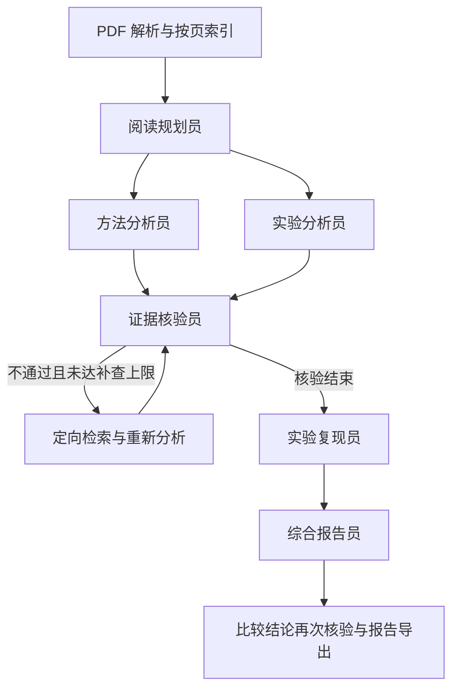

# PaperTeam：多智能体论文阅读与实验验证助手

基于 **LangGraph**，将论文阅读拆分为规划、方法分析、实验分析、证据核验、实验复现和报告综合六个角色。结论附 PDF 页码、可定位的文本块及原文片段；核验失败触发定向补查，达到轮次上限后排除仍未通过的结论。

## 已实现

- 批量读取 `paper/` 中的文本型 PDF，按页分块，使用 SHA256 缓存。
- 本地 BM25 风格检索，不依赖额外的 embedding API。
- 方法和实验分析并行编排，共享状态；API 请求串行，适配学校接口的并发配额。
- 引用块、所属论文和连续原文片段的程序校验，以及独立模型的语义核验。
- 最多两轮补查，SQLite 检查点、逐节点事件和 API token/耗时记录。
- MAC-SQL 实验适配器：下载固定提交的官方代码，重用原提示词、SQL 解析和 EX 评估函数。
- Streamlit 界面和命令行，支持单智能体、仅分工、分工加核验三组配置。

**复现范围必须准确表述：当前是 MAC-SQL 的方法级微型验证，不是论文完整结果复现。**实验使用本项目构造的 SQLite 数据库和当前 API 模型，未下载 BIRD/Spider 完整数据、未训练 SQL-Llama，也未在微型模式上启用 Selector。其他论文当前支持阅读，尚无执行适配器。

## 快速开始（Windows / PowerShell）

需要 Python 3.11 或更新版本，建议 Python 3.12。

```powershell
git clone https://github.com/LinksLid/Agent-for-Paper-Reading.git
cd Agent-for-Paper-Reading
powershell -ExecutionPolicy Bypass -File scripts/setup.ps1
```

将自己的 PDF 放入 `paper/`。仓库不附带论文原文件、密钥或运行缓存。

项目根目录新建 `.env`，也可从 `.env.example` 复制：

```dotenv
Base_url=https://your-provider.example/v1
API_KEY=your-key
# 可选：留空时从 /models 选择小型聊天模型
MODEL=
MAX_API_CALLS=30
API_TIMEOUT=120
```

兼容 `OPENAI_BASE_URL`、`OPENAI_API_KEY` 和 `OPENAI_MODEL`。API 使用兼容的 `/models` 与 `/chat/completions` 协议；凭据仅由本地客户端读取，不传入图状态或日志。选中的论文片段会发给该 API 服务，请使用允许处理这些论文的端点。服务如需校园网，请先确保本机网络可访问。

### DeepSeek 优先与 20 元预算

可将 DeepSeek 官方配置保存在根目录 `deepseek.env`（参见 `deepseek.env.example`），备用同济配置继续放在 `.env`。检测到 `deepseek.env` 时自动优先使用 `deepseek-flash`，余额不足、HTTP 402 或预算不足以预留下一次请求时，在同一个工作流中改用 `.env` 的接口。没有 `deepseek.env` 时直接读取 `.env`。可通过 `--provider tongji` 显式使用备用接口。

累计预算上限为 20 元，可通过 `DEEPSEEK_BUDGET_CNY` 调低；不能调高。每次付费调用前查询官方人民币余额，并根据输入 UTF-8 字节上界、输出 token 上限和官方高峰费率保守预留费用。使用量返回后按高峰费率结算预留；超时等无法取得用量的请求保留全额预留。记录持久化在 `.cache/deepseek-budget.sqlite`，跨重启和本机多进程共享；不要删除该文件来重置预算。

预算记录是保守上界，可能早于实际花满 20 元时切换；账单以服务商为准。账户内其他客户端引起的余额下降也计入保护。费率快照来自 [DeepSeek 官方价格表](https://api-docs.deepseek.com/zh-cn/quick_start/pricing/)，日期为 2026-10-26，Flash 高峰输入/输出为每百万 token 2/8 元，Pro 为 9/27 元；价格调整后需同步维护 `budget.py`。无法查询人民币余额时保守切换备用接口。切换事件、实际使用的模型和预算信息写入本地日志；预算切换自动测试使用模拟响应，不消耗真实账户来验证。

预算数据库和两份实际配置均不提交 GitHub。账户充值、手动删除预算库或更换密钥会改变预算追踪的前提；此机制不是服务商账户级消费限额。

```powershell
# 启动本机界面
powershell -ExecutionPolicy Bypass -File scripts/start.ps1

# 仅解析论文，不调用 API
.venv/Scripts/python.exe -m paperteam index

# 查看可用模型
.venv/Scripts/python.exe -m paperteam models

# 建议先跑同一任务领域的两篇论文
.venv/Scripts/python.exe -m paperteam read --paper MAC-SQL --paper CHESS --reproduce --samples 3

# 阅读文件夹里的全部论文
.venv/Scripts/python.exe -m paperteam read

# 独立执行 MAC-SQL 微型实验（1 至 6 个问题）
.venv/Scripts/python.exe -m paperteam reproduce --samples 6
```

Linux/macOS 可以使用 `python3 -m venv .venv`、`.venv/bin/pip install -r requirements.txt` 和 `.venv/bin/streamlit run app.py`。

## 协作流程



规划员确定检索维度；方法和实验分析员获取不同证据；核验员的反馈决定补查内容。复现员评估固定适配器的可行性，并调用有边界的运行器。报告员根据已接受的结论提出比较，比较结论也经过校验后才进入报告。程序节点和六种角色不一一对应。

## 结果在哪里

每次运行生成独立的 `output/<run-id>/`：

| 文件 | 用途 |
|---|---|
| `report.md` | 中文阅读报告及证据脚注 |
| `state.json` | 阅读计划、所有结论、核验历史和节点事件 |
| `manifest.json` | 模型、论文哈希、运行配置、耗时和 token 总量 |
| `api_usage.jsonl` | 每次逻辑调用的角色、请求次数、状态、用量、耗时 |
| `checkpoints.sqlite` | LangGraph 持久化检查点，便于检查中间状态 |
| `workflow.mmd` | 本次实际编排图 |
| `comparison_audit.json` | 比较结论核验记录 |
| `reproduction/reproduction.json` | 源码版本、实验范围、逐样本分数及限制 |
| `reproduction/cases.json` | 问题、参考 SQL、预测 SQL、执行错误和修正轨迹 |

检查点可用于调试；当前界面未提供跨进程继续运行按钮。运行失败会保存失败清单及已有日志，不伪造报告或实验分数。

## 实验复现的实现边界

MAC-SQL 来源锁定在 [`config/macsql.lock.json`](config/macsql.lock.json)。使用 GitHub 指定提交的源码压缩包下载，校验解压路径、大小和关键文件 SHA256，不自动运行 README 命令或模型生成的 shell。

适配器读取官方 `core/const.py` 的字符串提示词，从校验过的源码中加载 `parse_sql_from_string` 与 `execute_sql` 两个函数；不执行整个仓库模块的导入或安装脚本。新版兼容 API 和 LangGraph 调度由本项目实现。

小型实验包含单表筛选、连接、聚合、子查询、空关联和 HAVING 六类问题；每条预测 SQL 在两个数据库变体上测试。参考 SQL 仅提供给评分阶段。数据库连接强制只读，禁止 ATTACH、写操作和扩展加载，查询有执行时限。

同时记录官方的结果集合 EX 与多重集比较。它们仍不能覆盖所有 SQL 等价情形，尤其是排序语义。基线和分解修正流程使用相同模型、模式和问题，但提示词长度、示例、调用次数不同；**不能用该微型实验直接证明多智能体更优，也不能与论文榜单分数比较**。

## 课堂对照实验

```powershell
.venv/Scripts/python.exe -m paperteam read --paper MAC-SQL --paper CHESS --mode single
.venv/Scripts/python.exe -m paperteam read --paper MAC-SQL --paper CHESS --mode multi
.venv/Scripts/python.exe -m paperteam read --paper MAC-SQL --paper CHESS --mode verified
```

三组都保留基础的原文定位校验，`verified` 额外增加语义核验和补查。当前它们是配置对照，并非严格等预算消融：检索材料、提示词和调用次数不同。正式报告应人工标注事实正确率、引用支持率、关键点覆盖率，并同时报告 token 与耗时。详见 [评测方案](docs/evaluation.md) 和 [六人分工与汇报提纲](docs/team-project.md)。

## 开发与测试

```powershell
.venv/Scripts/python.exe -m pytest -q
```

自动测试不调用真实 API。覆盖引用错误、核验补查、检查点、配额控制、格式重试、源码校验、只读 SQL、修正上限和界面加载。真实 API 的运行情况单独记录，不能把测试夹具结果当成实际论文分析或实验成绩。当前验证结果见 [实际验证记录](docs/validation.md)，运行清单与微型实验逐样本结果保存在 `examples/`。

## 当前限制

- 只解析可提取文本的 PDF；双栏顺序、表格、图片与公式需要人工复核，暂无 OCR 或视觉解析。
- 原文定位校验不代表结论语义一定正确；同一底层模型的多个角色可能共享偏差。
- 每个分析角色默认只提取少量主要结论，报告不等同于完整综述。
- 当前检索没有重排器，中文问题对英文全文的检索依赖规划员提供英文关键词。
- 自动模型选择以名称匹配为依据，重要实验应显式固定 `MODEL`。
- 学校 API 可能有网络、并发和速率限制；程序采用单请求并发、有限次数退避重试与调用预算。

## 官方参考

- [LangGraph 图与状态 API](https://docs.langchain.com/oss/python/langgraph/graph-api)
- [LangGraph 持久化](https://docs.langchain.com/oss/python/langgraph/persistence)
- [MAC-SQL 官方仓库](https://github.com/wbbeyourself/MAC-SQL)
- [MAC-SQL 论文](https://aclanthology.org/2025.coling-main.36/)
- [CHESS 官方仓库](https://github.com/ShayanTalaei/CHESS)

第三方源码保留在本地 `external/`，不作为本项目原创代码提交；使用时请遵守上游条款。
