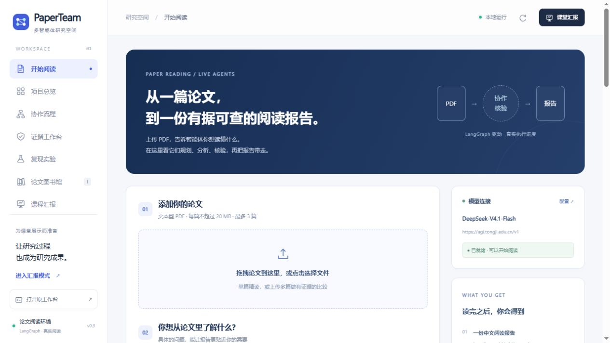
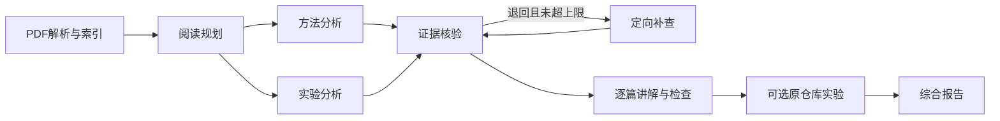

# PaperTeam · 可视化多智能体论文阅读工作台

**上传论文 PDF → 输入阅读问题 → 实时查看智能体协作 → 获得有原文证据的中文报告。**

基于 LangGraph 的完整本地应用。新首页可以真正调用模型阅读论文；项目总览、证据工作台、实验记录和课程汇报作为辅助页面保留。



## 下载后运行

需要 **Python 3.11+**，推荐 3.12；首次安装依赖需要网络。无需 Node.js、GPU 或 Docker，即可阅读文本型论文。

1. GitHub 点击 **Code → Download ZIP**，解压。
2. Windows 双击 **`start.bat`**；macOS/Linux 运行 **`sh start.sh`**。
3. 首次启动自动创建 `.venv`、安装 `requirements.txt`，随后自动打开 **http://127.0.0.1:8600/#read**。
4. 首页右侧“模型连接 → 配置”：填写自己的 Base URL、模型名称和 API Key，保存到本机 `.env`。已有 `.env` 自动读取。
5. 上传 1—3 篇 PDF，填写阅读问题，点击 **开始阅读**。
6. 观察真实的节点执行状态；完成后查看 **阅读报告 / 原文证据 / 执行日志**，下载 Markdown 报告，或打印保存 PDF。

每篇 PDF 最大 20 MB、150 页，支持可提取文字的 PDF；扫描版需要先 OCR。一次仅运行一个任务。论文文字会发送到你配置的模型服务并消耗额度；密钥不会返回浏览器或包含在发布包里。

运行后保持终端窗口开启，Ctrl+C 停止网站。也可执行：

```bash
python launch.py
python launch.py --port 8602           # 更换端口
python launch.py --no-browser          # 不自动打开浏览器
```

PyCharm：打开整个仓库，选择 Python 3.11+ 解释器，运行 **`launch.py`**。启动器自动准备虚拟环境；后台阅读任务使用该环境。

**没有 API Key 也能打开网站和历史案例，但不能生成新的阅读报告。** 双击 `index.html` 或 GitHub Pages 仅提供静态演示；真正上传和执行需要运行本地 Python 服务。

## 首页能做什么

| 功能 | 实际行为 |
|---|---|
| 上传论文 | 拖放或选择 PDF，保存到本机 `.cache/web-jobs/uploads/` |
| 提出问题 | 全面精读、重点看方法、重点看实验，或自定义要求 |
| 选择模式 | 默认多智能体+语义核验；提供单智能体和不做语义核验的对照模式 |
| 实时进度 | 解析、规划、方法/实验分析、核验、定向修订、讲解、报告；来自真实开始/结束事件 |
| 查看报告 | 方法、改进、实验、局限、引文；点击证据页码打开上传的原 PDF |
| 下载与打印 | Markdown 下载；浏览器打印可保存 PDF |
| 划词提问 | 在报告或证据中选字，点击“问一下”；支持原文检索、解释核验、追问及本地历史恢复 |
| 运行管理 | 调用上限、已返回 token 数、停止任务、最近阅读与刷新后恢复 |
| 模型连接 | OpenAI 兼容 Chat Completions 接口；本机保存自己的配置 |

进度只显示已发生的事件和已返回的用量，不虚构完成百分比。停止任务会保留已产生的日志，正在进行的远端请求可能仍已计费。

## 其他展示页面

项目总览展示已保存的研究记录；协作流程回放历史节点；证据工作台支持筛选；实验页显示小样本结果和限制；论文库比较机制；课程汇报提供对应六项课程要求的汇报页。右上角“课堂汇报”用左右键翻页、Esc 退出；姓名仅存在当前浏览器。

随包案例是 **2026-11-01 的公开历史节选**，不是下载者刚跑出的成绩。88 条是系统接受数量，不是人工准确率。浏览历史案例不会调用模型。

## 模型与高级入口

网页“模型连接”可保存配置，也可以复制 `.env.example` 为 `.env`：

```dotenv
Base_url=https://your-provider.example/v1
API_KEY=replace-with-your-own-key
MODEL=your-model-id
MAX_API_CALLS=80
API_TIMEOUT=180
REASONING_EFFORT=
```

兼容同济示例：Base URL 为 `https://agi.tongji.edu.cn/v1`，模型名称按自己套餐可用项填写。其他用户需要自己的 Key，不会共享本团队额度。

可选的原 Streamlit 实验工作台：`python launch.py --workbench`，地址 http://127.0.0.1:8501。新网站首页直接执行阅读，无须跳转。

只看历史演示且不安装依赖：`python launch.py --presentation-only`。更新静态数据用 `python -m paperteam.showcase --export-only --data-mode demo`。

高级命令（使用已安装依赖的解释器）：

```bash
python -m paperteam index
python -m paperteam read --paper MAC-SQL --mode verified --max-repairs 1 --provider tongji
python -m paperteam reproduce --paper ReAct --samples 2 --provider tongji
python scripts/download_paper_catalog.py
```

`tongji` 是配置选择器，读取用户自己的 `.env`。高级多服务策略见[技术参考](docs/technical-reference.md)。

## 框架如何协作



六个主要角色：规划员、方法分析员、实验分析员、证据核验员、实验复现员、报告员。LangGraph负责共享状态、汇合与条件返工，SQLite提供检查点；逐篇讲解是报告员的子流程。

实验子图依次搜索/核对官方仓库、下载固定提交、检查前提、验证计划、容器执行、按实际错误修复一次、读取实际产物。图中并行分支不代表API请求实际并发，同一模型的多个角色仍可能共享偏差。

真正执行第三方仓库还需要 **已启动的Linux Docker引擎**、真实数据及必要模型资源。缺前提时保留原因，不直接在宿主机执行下载代码，也不删除原方法模块来制造复现成功。

## 随仓库提供的历史结果

| 案例 | 保存的小样本结果 |
|---|---|
| MAC-SQL | BIRD前6题，执行评估5/6 |
| ReAct | ALFWorld两个文本任务，成功1/2 |
| Multiagent Debate | 原解析器末轮3/10；同一输出的额外格式审计10/10，两种口径不能混用 |
| Self-Refine | 首轮2/2；反馈后程序未变，未观察到提升 |
| Tree of Thoughts | 低预算greedy1搜索0/2，单次CoT原评分0/2；存在格式兼容问题 |
| CHESS / KnowTrans / LLaVA | 受embedding、权重、图像或计算资源限制，不计作0分 |

这些运行替换模型、缩小样本或调整参数，**所有 `full_paper_reproduced=false`**。依据见[公开演示数据](examples/public-demo.json)、[评分摘要](showcase/data/artifacts)和[演示数据说明](docs/demo-data.md)。完整PDF、第三方源码、大型数据与权重不随仓库分发。

## Docker和在线演示

运行完整阅读网站（首次构建安装依赖）：

```bash
docker compose up --build -d
# 打开 http://127.0.0.1:8600
# 停止：docker compose down
```

镜像包含真实阅读依赖。可在网页配置模型，或准备本机 `.env` 由 Compose 注入；上传文件和输出通过卷保留。修改 `.env` 后重建容器使环境变量生效。该入口不提供 Docker 内再嵌套运行第三方仓库实验。

仓库附带手动触发的[GitHub Pages工作流](.github/workflows/pages.yml)。配置Pages的GitHub Actions来源后，运行工作流可发布静态演示；Pages不运行Python、模型或容器，也不保存密钥。操作见[GitHub发布指南](docs/github-release.md)，配置依据[GitHub官方文档](https://docs.github.com/en/pages/getting-started-with-github-pages/using-custom-workflows-with-github-pages)。

## 目录与开发

```text
launch.py / start.bat / start.sh   统一启动入口
showcase/                        HTML/CSS/JS、公开快照和评分摘要
examples/public-demo.json         历史记录的可分发节选
paperteam/                       LangGraph、模型接口、核验和容器执行
paperteam/web_jobs.py             上传、后台任务、真实进度与报告接口
app.py                           可选 Streamlit 实验工作台
paper/                           用户PDF，不提交全文
config/paper-catalog.json          官方论文目录
docker/                          实验工具镜像
tests/                           不调用真实付费API的软件测试
docs/                            使用、架构、评测和发布文档
output/ external/ .cache/         本机运行、下载和缓存，不提交
```

```bash
python -m pip install -r requirements.txt
python -m pytest -q
python -m paperteam.showcase --export-only --data-mode demo
```

CI包含软件测试及不安装模型依赖的首次启动检查。[本次发布验证](docs/release-validation.md)记录真实网页阅读和软件、独立目录等检查。使用顺序、故障处理和课堂演示见[使用手册](docs/user-guide.md)。评测参考[人工评测清单](docs/人工评测与课堂演示清单.md)。

## 来源与许可

基于 [LinksLid/Agent-for-Paper-Reading](https://github.com/LinksLid/Agent-for-Paper-Reading) 的指定提交扩展，保留原作者署名。检查的上游版本未附许可证，本整理不擅自将全部代码重标为MIT等许可；详见[NOTICE](NOTICE.md)。团队应如实列出本组改造和成员贡献。
