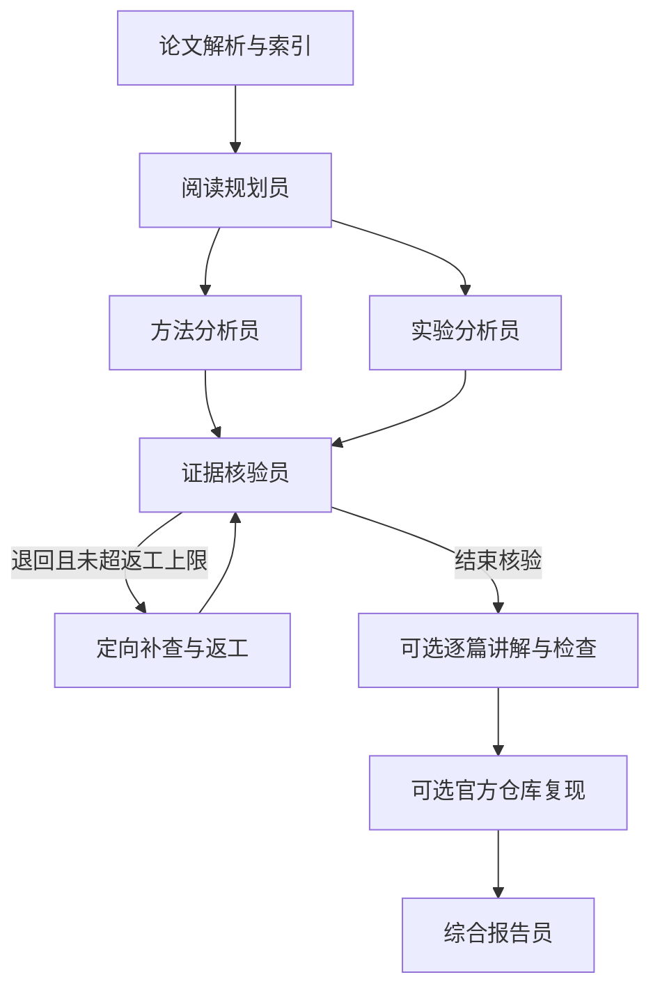

# PaperTeam 本地部署与实测反馈（可转发给项目维护者）

## 2026-11-01 补充：可交互论文阅读网站（v0.3）

新网站首页直接上传 PDF 并执行 LangGraph 阅读，不再需要跳转到 Streamlit。支持自定义问题、三种协作模式、实际节点开始/结束状态、停止任务、原文页码与引文、Markdown 下载和打印 PDF、最近阅读及刷新恢复。默认不运行第三方仓库实验。

通过网页上传 MAC-SQL.pdf（18 页）完成一次真实核验阅读：208.094 秒、18 次模型调用、156,123 tokens；最终接受 10 条结论、未接受 2 条，核验 2 轮，详细讲解覆盖检查 8/8。上述数字是这一次运行的记录，系统接受数和覆盖检查均不是人工事实准确率。

本机结果保存在 `output/web-be4a304efcb74c28810e9e74b1535bf0/`。源码包不携带这次上传的 PDF、个人 .env 和运行日志。GitHub 下载者使用自己的模型连接。新的直接运行入口为 `start.bat` / `sh start.sh` / `python launch.py`，默认网站端口 8600，原 Streamlit 高级入口保留在 `--workbench`。

您好，我们将 [Agent-for-Paper-Reading](https://github.com/LinksLid/Agent-for-Paper-Reading) 用于多智能体课程项目。已在 Windows 的 E 盘完成部署、接通同济模型服务，并实际运行八篇论文阅读及多个原仓库的小样本实验。下面集中反馈可核验结果、兼容性问题和建议修改；希望作为后续改进与交流材料。

检查基础提交：`dcf0e17bb7312b3758df12a1f339b19a5857f7b2`。本分支包含可视化网站与可移植部署改造，实验结果仍对应下述本机历史运行。报告更新：2026-11-01T15:31:28.881252+08:00。

## 1. 当前系统实现了什么

这是基于 LangGraph 的多角色论文阅读与实验验证工作流。共享状态保存论文、计划、结论、引文、核验反馈与实验记录，SQLite 提供检查点。主要角色为阅读规划员、方法分析员、实验分析员、证据核验员、实验复现员、综合报告员，另有逐篇讲解生成与检查流程。多个角色当前主要使用同一个底层模型，角色分工不意味着模型具有独立知识或错误互不相关。

逻辑流程为：PDF解析与索引 → 阅读规划 → 方法/实验分析 → 引文与语义核验 → 有限补查返工 → 通过项汇总；可选复现分支再执行官方仓库核对、下载、环境检查、计划验证、Docker执行、一次修复与原产物评分。运行图中的分支不等于接口请求实际并发。

以下为按源码整理的逻辑示意，非逐步执行轨迹：

系统能进行多论文证据整理，并尝试执行原仓库；它不是只聊天的论文摘要助手。当前也不是可以对任意论文全自动完成实验的通用科研系统：仓库入口识别、计划正确性、数据、模型和运行预算仍可能成为障碍。

## 2. 本地环境与验证

| 项目 | 当前状态 |
|---|---|
| 主项目 | `E:\Projects\PaperTeam` |
| 宿主解释器 | `.venv\Scripts\python.exe`，Python 3.12.14；实验使用独立 Linux Python 3.11 容器 |
| IDE | 已有 PyCharm Community Edition 2022.3.2；已写入 `.run/` 运行配置 |
| Docker / WSL | Docker Desktop 4.97.0、CLI 29.9.2、WSL 3.0.3；Linux容器实测通过；程序与数据放在E盘 |
| 机器条件 | 8GB内存、MX250 2GB显存；WSL限3GB内存/2CPU；本轮使用CPU容器 |
| 模型服务 | `https://agi.tongji.edu.cn/v1`，`DeepSeek-V4.1-Flash`，`reasoning_effort=none` |
| 自动测试 | **80 passed**；这表示软件回归通过，不代表阅读事实准确率 |
| 本地结果页 | `http://127.0.0.1:8501/Local_Validation` |

真实密钥保存在被Git忽略的本地 `.env`。第三方实验代码在容器中使用临时代理凭证，主机服务密钥不挂载到原仓库。附件不含真实密钥、登录缓存或完整论文与数据。

## 3. 八篇论文阅读的实际结果

本次 verified 模式对八篇论文完成阅读、核验、一次返工与逐篇讲解，耗时 **1341秒（约22分21秒）**，记录 **106次模型调用、968,596 tokens**。最终保留88条结论，排除8条；第一轮84条通过、12条退回，第二轮88条通过、8条退回。

返工会重新生成结论卡片，两轮不是完全相同的条目集合，不能据此计算“修正了4/12错误”。88/96是本系统的核验接受比例，也不能称为人工测得的事实准确率。尚未完成人工标准答案与独立评审。

| 讲解 | 系统状态 | 结构覆盖 | 待补查部分 |
|---|---|---:|---|
| chess.pdf | partial | 5/8 | 任务、输入与输出、教学示例 |
| knowtrans.pdf | partial | 6/8 | 输入与输出、教学示例 |
| llava.pdf | ready | 8/8 | 无结构缺项 |
| MAC-SQL.pdf | partial | 5/8 | 输入与输出、原有做法与难点、教学示例 |
| multiagent-debate.pdf | ready | 8/8 | 无结构缺项 |
| react.pdf | ready | 8/8 | 无结构缺项 |
| self-refine.pdf | ready | 8/8 | 无结构缺项 |
| tree-of-thoughts.pdf | partial | 7/8 | 教学示例 |

ready只表示本系统的结构检查与核验通过；partial项按原样保留，未隐藏。完整阅读报告保存在本地 `output/tongji-all-papers-20261101/report.md`，附件仅含运行清单、结构覆盖与删去原文长引文的退回案例，便于转发。

## 4. 新模型实验结果

**全部为有限样本、替换模型后的方法或子集验证，所有结果的 `full_paper_reproduced=false`。没有宣称重现论文完整成绩。** 旧代码中的gpt-4、text-davinci、code-davinci只是代理前的请求别名，实际调用均为上述同济模型。不同任务指标不作横向排名。

| 论文/方法 | 本轮数据与设置 | 实际结果 | 解释限制 |
|---|---|---|---|
| MAC-SQL | 官方BIRD dev前6条，原入口与原执行评估器 | **EX 5/6（83.33%）**；逐题 `[1,1,1,1,0,1]` | 6题均来自california_schools；未按结果筛题，不代表完整BIRD |
| ReAct | 官方ALFWorld valid_unseen，原notebook流程，2个实际episode | **1/2（50%）** | 保留原动作循环与won判定；旧Completion转聊天接口加了续写约束，未执行Wikipedia任务 |
| Multiagent Debate | 原算术生成器seed=0、前10题、2智能体、3轮，共60次回答 | 原解析器首轮2/10、末轮3/10；额外格式审计首轮10/10、末轮10/10 | 格式审计不是原论文分数，首轮复用同一运行，不是独立等预算基线；未证明辩论提升推理 |
| Tree of Thoughts | Game24题号900、901；另开的低预算propose1/value1/greedy1，与每题1次CoT | ToT 0/2；CoT 0/2（原评分器） | 标准value3/greedy5运行在600秒内未完成；低预算结果不能冒充原超参数复现，CoT与搜索预算不等 |
| Self-Refine | 原gsm.jsonl前2条，原fix_gsm与代码评估器，最大4次尝试 | 初始 2/2；截至第4列累计命中 2/2 | 修正评估分母为实际2；累计命中不等于最终答案准确率；生成代码仅在容器内执行 |

MAC-SQL评分来自原 `eval_result_dev.json`。ReAct真实任务分别为 `look_at_obj_in_light-Bowl-None-DeskLamp-308/trial_T20190907_133919_856963`（成功）和 `pick_two_obj_and_place-SoapBar-None-GarbageCan-424/trial_T20190909_064221_368939`（失败）；导出的rs合计1、cnts合计2。BIRD数据虽可挂载到ReAct容器，但ReAct并未使用它。

Self-Refine的两题首轮即正确，各经过一次反馈便停止；保存的两个最终程序均与首轮程序完全相同，因此本次没有观察到反馈收益。累计准确率来自原评估器，程序一致性另有确定性审计文件。

ToT的单次CoT对照另有格式诊断：题900的输出达到1000-token上限后未完成最终回答；题901给出了正确算式，但粗体`**Answer:**`无法被原评分器的简单文本提取识别。仅将这个粗体标签改成普通`Answer:`后，原评分器对题901由0变1，题900仍为0；这是复用同一输出的补充审计，不覆盖原评分，不代表重新运行CoT或搜索。各配置均保留真实的原评分与预算差异。

从ToT源码与已保存的题900搜索轨迹看，原提议函数将模型回复按换行拆成候选；替换模型返回了Markdown、说明与空行，使单分支配置的四步仍分别出现57、65、42、71条候选。这里的“单分支”只限制保留的状态数，不限制需要评价的候选数。这个诊断说明当前接口/输出格式兼容性会影响运行成本与结果，不能仅用最终分数归因于搜索方法优劣；后续可增加结构化格式与合法步骤检查，并作为单独适配实验重新评价。

辩论实验60次回答已经完成，但原脚本导出JSON时因NumPy整数不可序列化而退出1。我们保留失败日志，在隔离容器内读取原有pickle并重新导出、评分，**没有再次生成答案**。另做的数值格式审计发现：例如正确的粗体Unicode负数会被原解析器忽略，回退取了前文数字。额外审计不能替换原评分，也没有删掉任何失败题。

### 尚受阻的原论文

| 论文 | 本机检查结果 | 建议 |
|---|---|---|
| CHESS | 官方BIRD前2条已就绪；原检索依赖embedding，当前代理只支持聊天/Completion，不支持所需embedding | 补兼容embedding与检索索引后再试，不能删除检索模块冒充原方法 |
| KnowTrans | 缺原基座/LoRA等权重与训练推理条件，CPU小内存不足以执行原7B流程 | 作为阅读案例；换有资源机器或取得作者可用的推理资产 |
| LLaVA | 缺原权重、图像评测数据与所需GPU条件 | 暂不作为本机现场实验主线，云端多模态模型不能替代原LLaVA实验 |

这些是可定位的前提缺口，不是实验分数0；不把“下载了论文/仓库”算作复现成功。

## 5. 实现中解决的三个核心难题

1. **让证据检查真正约束报告。** 本次退回记录包含引文非连续原文、结论超出引文支持等情况。例如CHESS讲解的任务/输入输出项引用了背景或局部模块描述，无法支持完整定义，系统仍标为partial。建议展示“原结论—定位片段—退回理由—修改或排除”的真实链路；不能将所有退回都解读为事实错误。
2. **仓库与依赖兼容性。** 原入口检查漏掉辩论仓库的 `math/gen_math.py`，导致误称缺数据；已扩展嵌套入口覆盖。Debian HTTP下载失败改为HTTPS；NumPy1.22.4与Python3.11不兼容；ALFWorld当前get_environment返回类，必须再实例化，并绑定真实数据与包内PDDL路径。Self-Refine的prompt-lib需固定源码提交及旧SDK依赖。以上属于工程适配，不是算法创新。
3. **结果与计划也必须核验。** 自动计划曾包含非连续源码引用、错误的n采样拆分和导出路径；只把n改为1却仍按原批量数扣减会少生成候选，必须改循环计数。ToT硬编码GPT费用与实际同济模型无关，已停止报告该金额。另修复了超时后先杀容器而丢失tmpfs产物的问题：改为容器内限时终止命令，留容器存活以便验证、导出，主机保留有限超时兜底。真实容器冒烟检查已验证退出124后仍成功取回预先生成的JSON。数值解析失败、导出失败、超时和人工修复均保留，不能只展示最后成功日志。

复现流程包含自动规划/一次错误修复，也包含本次检查源码后人工编写的兼容计划。附件中保留plan来源与manual-review记录；**不宣称全程无人干预**。

## 6. 按课程要求，目前做到什么程度

| 课程要求 | 已有基础与本轮证据 | 还需团队完成 |
|---|---|---|
| 目标、背景与选择原因 | 多论文阅读、可追溯比较、检验真实实验，任务复杂性足够 | 收敛课堂主线，建议MAC-SQL/CHESS阅读对比，加辩论/反馈/搜索的小实验 |
| 成员角色分工 | docs/team-project.md提供6人模块分工建议 | 写实际姓名、个人实现/测试与提交记录；建议分工不等于已完成贡献 |
| 开源框架、角色、目标与协作 | LangGraph状态、分析分支、核验返工、复现子图与检查点已存在并运行 | 讲清每个角色实际输入输出，区分原项目功能与本组新增改造 |
| 2—3个核心难题 | 本节已有真实失败、定位、修复、未解决缺口 | 每个难题选一段日志和前后产物，组织为可演示案例 |
| 运行结果 | 八篇阅读、原评估产物、小样本真实推理、token与耗时日志 | 做人工质量评测、单智能体/仅分工/加核验的受控对照与更广数据覆盖 |
| 经验与反思 | 共同模型偏差、核验成本、格式评估与资源约束都有证据 | 用团队自己的测量支持结论，录制稳定演示并制作汇报材料 |

当前可称为**已部署、可运行、有真实实验支撑的课程项目原型**；不能说课程评估或完整论文复现已经全部完成。直接采用开源项目并部署不足以证明“自己构建与优化”，建议明确本组在入口检索、API适配、可靠导出、约束验证、评测和界面上的贡献。

建议下一轮固定15—20个带人工参考答案的问题，对比单阅读者、仅分工、分工加核验返工。固定论文版本、检索证据池、输出条数/格式与预算；记录事实正确率、证据支持率、关键点覆盖率、不可直接比较实验的识别，以及耗时/token/失败数。若预算不能完全匹配，应分别给出质量与成本并说明差异。建议3次重复并保留逐题结果，不预设多智能体一定更好。

附件另附`人工评测与课堂演示清单.md`：20个待人工标注问题、指标定义、5分钟演示安排及待填真实姓名/贡献的六人表。它是待执行模板，不是已完成的人工作答或成绩。

## 7. 三篇新增论文的选择建议

| 建议顺序 | 论文与官方实现 | 为什么适合、注意什么 |
|---|---|---|
| 1 | [Multiagent Debate](https://github.com/composable-models/llm_multiagent_debate) | 原生多个角色交流，算术有客观答案，无需本地权重。本轮已完成10题；先修评分格式再增加难度，补同预算独立采样对照 |
| 2 | [Self-Refine](https://github.com/madaan/self-refine) | 清晰的生成—反馈—改写循环；是同模型迭代方法，可作为反馈基线，不能直接称其原生多智能体。GSM代码任务需隔离执行与旧依赖适配 |
| 3 | [Tree of Thoughts](https://github.com/princeton-nlp/tree-of-thought-llm) | Game24数据与客观评分容易取得，可展示候选生成、状态评价与搜索；搜索调用可能很多，先使用明确标注的低预算配置 |

三篇PDF与官方源码均已补充；不能因为不训练就称它们“零成本”。本轮所有日志合计已记录 **1012次请求、2,116,744 tokens**（包含检查、失败、重试、规划和阅读；按本机日志统计，不是平台账单）。阅读本身106次调用、968,596 tokens；其他成本见附件逐次运行摘要。MAD的恢复评分复用旧推理，恢复目录不重复计为60次新推理。未推算积分或美元费用，也未验证平台剩余额度。

### 逐次运行成本与失败记录

| 运行目录 / 论文 | 记录请求数 | tokens | 运行秒数 | 状态 |
|---|---:|---:|---:|---|
| `reproduction-20261101-141911-211744` / MAC-SQL.pdf | 17 | 80,680 | 217.234 | completed |
| `reproduction-20261101-142352-e02265` / chess.pdf | 12 | 122,449 | 194.563 | blocked |
| `reproduction-20261101-142352-e02265` / knowtrans.pdf | 12 | 122,449 | 194.563 | blocked |
| `reproduction-20261101-142352-e02265` / llava.pdf | 12 | 122,449 | 194.563 | blocked |
| `reproduction-20261101-142352-e02265` / react.pdf | 12 | 122,449 | 194.563 | failed |
| `reproduction-20261101-142831-f21c05` / multiagent-debate.pdf | 3 | 16,882 | 17.718 | blocked |
| `reproduction-20261101-143141-8e29f8` / multiagent-debate.pdf | 62 | 55,453 | 209.546 | failed |
| `reproduction-recovered-20261101-143806` / multiagent-debate.pdf | 0 | 0 | 18.235 | completed |
| `reproduction-20261101-144214-39bcb5` / self-refine.pdf | 6 | 57,581 | 69.187 | failed |
| `reproduction-20261101-144214-39bcb5` / tree-of-thoughts.pdf | 6 | 57,581 | 69.187 | failed |
| `reproduction-resumed-20261101-143555-a666db` / react.pdf | 1 | 16,247 | 557.094 | failed |
| `reproduction-20261101-145420-f196dc` / chess.pdf | 1 | 23,942 | 19.844 | blocked |
| `reproduction-resumed-20261101-145240-fc6a27` / react.pdf | 79 | 190,254 | 354.937 | completed |
| `reproduction-resumed-20261101-150212-574d25` / self-refine.pdf | 1 | 28,306 | 178.593 | failed |
| `reproduction-resumed-20261101-145239-0eb196` / tree-of-thoughts.pdf | 260 | 182,237 | 855.219 | failed |
| `reproduction-resumed-20261101-150712-3621d5` / self-refine.pdf | 1 | 28,494 | 193.61 | failed |
| `reproduction-resumed-20261101-151210-084474` / self-refine.pdf | 5 | 15,674 | 139.453 | completed |
| `reproduction-resumed-20261101-150803-18db34` / tree-of-thoughts.pdf | 262 | 190,071 | 1005.625 | failed |
| `reproduction-resumed-20261101-151902-5ed116` / tree-of-thoughts.pdf | 195 | 139,753 | 651.859 | completed |

同一运行包含多篇论文时，请求与时间是该运行合计，各行不能重复相加；准确全局合计以上述日志统计为准。时间包含环境准备、安装、执行与分析，不能当作纯模型推理延迟。

## 8. 建议维护者优先修改

1. 增加带固定提交、最小真实数据、原评估器与完整导出的低资源案例；预先区分聊天、embedding、视觉、本地权重等能力前提。
2. 对计划做精确源码匹配、路径检查和样本/采样数一致性检查；自动修复应根据实际错误改变条件，不能在同样上限下重复超时。
3. 将数据可用与“数据实际被该任务使用”分开记录；例如ReAct不使用BIRD，辩论的算术题由原脚本生成。
4. 原样保留失败数、解析失败、人工介入与运行成本；报告员应直接读取逐题产物，避免出现“缺少episode明细”但文件中实际已有明细的错误描述。
5. 为阅读系统补独立人工评测和受控消融；模型自核验通过不能直接作为事实准确率。

## 9. 论文与复现实验索引

| 论文 | 页数 | 官方来源 |
|---|---:|---|
| MAC-SQL: A Multi-Agent Collaborative Framework for Text-to-SQL | 18 | [论文](https://arxiv.org/pdf/2312.11242) · [官方代码](https://github.com/wbbeyourself/MAC-SQL) |
| CHESS: Contextual Harnessing for Efficient SQL Synthesis | 41 | [论文](https://arxiv.org/pdf/2405.16755) · [官方代码](https://github.com/ShayanTalaei/CHESS) |
| ReAct: Synergizing Reasoning and Acting in Language Models | 33 | [论文](https://arxiv.org/pdf/2210.03629) · [官方代码](https://github.com/ysymyth/ReAct) |
| KnowTrans: Boosting Transferability of Data Preparation LLMs via Knowledge Augmentation | 22 | [论文](https://raw.githubusercontent.com/A11en0/KnowTrans/main/KnowTrans-Full-Version.pdf) · [官方代码](https://github.com/A11en0/KnowTrans) |
| Visual Instruction Tuning | 25 | [论文](https://arxiv.org/pdf/2304.08485) · [官方代码](https://github.com/haotian-liu/LLaVA) |
| Improving Factuality and Reasoning in Language Models through Multiagent Debate | 27 | [论文](https://arxiv.org/pdf/2305.14325) · [官方代码](https://github.com/composable-models/llm_multiagent_debate) |
| Self-Refine: Iterative Refinement with Self-Feedback | 54 | [论文](https://arxiv.org/pdf/2303.17651) · [官方代码](https://github.com/madaan/self-refine) |
| Tree of Thoughts: Deliberate Problem Solving with Large Language Models | 14 | [论文](https://arxiv.org/pdf/2305.10601) · [官方代码](https://github.com/princeton-nlp/tree-of-thought-llm) |

| 论文 | 最终可用状态 | 本地运行目录（output下） | 官方源码提交 |
|---|---|---|---|
| MAC-SQL.pdf | completed | `reproduction-20261101-141911-211744` | `31a9df5e0d520be4769be57a4b9022e5e34a14f4` |
| chess.pdf | blocked | `reproduction-20261101-145420-f196dc` | `3d6e835f858d26885d21d4bc0215aeecf855efbe` |
| knowtrans.pdf | blocked | `reproduction-20261101-142352-e02265` | `3d332e528c38ba20392952f4a7cec0f222ba2762` |
| llava.pdf | blocked | `reproduction-20261101-142352-e02265` | `c121f0432da27facab705978f83c4ada465e46fd` |
| react.pdf | completed | `reproduction-resumed-20261101-145240-fc6a27` | `6bdb3a1fd38b8188fc7ba4102969fe483df8fdc9` |
| multiagent-debate.pdf | completed | `reproduction-recovered-20261101-143806` | `9846749350eb917ae5bfaaff4c645fc705b8d3af` |
| self-refine.pdf | completed | `reproduction-resumed-20261101-151210-084474` | `9a206d41e5d2d0c241bb441f41eeadb945afaa55` |
| tree-of-thoughts.pdf | completed | `reproduction-resumed-20261101-151902-5ed116` | `8050e67d0e3a0fddc424d7fa5801538722a4c4cc` |

附件包括本报告、结果与调用统计摘要、选定原始评分/预测产物、失败与人工修复记录、论文来源哈希、测试XML、环境检查以及本地修改补丁/工具。完整PDF、原仓库快照、大型数据、二进制pickle、包含全文的state.json和密钥不放入转发包。运行目录中的原始产物继续保存在E盘，以便进一步检查。
